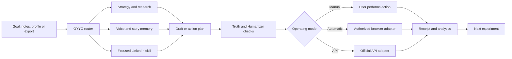

# 🤖 LinkedIn SuperAgent MultiSkills

<p align="center">
  <strong>Plan, write, audit and manage LinkedIn from the AI workspace you already use.</strong>
</p>

<p align="center">
  An open-source LinkedIn AI agent for content strategy, personal branding, profile optimization, analytics, social selling, recruiting, company pages and account workflows.
</p>

<p align="center">
  
</p>

<p align="center">
  <a href="https://github.com/vpicciuolo/Linkedin-SuperAgent-MultiSkills/releases/tag/v2.2.0"></a>
  
  
  
  
  <a href="LICENSE"></a>
</p>

<p align="center">
  <a href="#quick-start"></a>
  <a href="#examples"></a>
  <a href="#skills"></a>
  <a href="portable/OYYO_LINKEDIN_SUPERAGENT.md"></a>
  <a href="docs/INSTALL_EVERYWHERE.md"></a>
  <a href="https://hrn.ae/githubsupport"></a>
</p>

---

## Navigation

[Quick start](#quick-start) · [Problems solved](#problems-solved) · [Examples](#examples) · [Why use it](#why-use-it) · [How it works](#how-it-works) · [24 skills](#skills) · [Install everywhere](#install-everywhere) · [Operating modes](#operating-modes) · [Local worker](#local-worker) · [Safety](#safety) · [Support](#support)

> [!IMPORTANT]
> This repository is a free, open-source component of [OYYO ONE AI](https://oyyo.one). It is separate from the proprietary OYYO platform and is not affiliated with or endorsed by LinkedIn.

> [!WARNING]
> Automated LinkedIn profile management may violate LinkedIn's User Agreement or Professional Community Policies. Automatic mode is optional and is used entirely at your own risk. Manual mode is the default. You remain responsible for every action taken on your account.

<a id="quick-start"></a>

## ⚡ 30-second quick start

### Use it now in ChatGPT, Claude, Perplexity or Gemini

1. Download [`portable/OYYO_LINKEDIN_SUPERAGENT.md`](portable/OYYO_LINKEDIN_SUPERAGENT.md).
2. Attach it to a chat, Project or knowledge workspace.
3. Send this message:

```text
Start OYYO LinkedIn SuperAgent in manual mode.
Help me define my audience, voice and first LinkedIn goal.
```

Manual mode needs no LinkedIn login, API key or additional software.

### Install it as an agent plugin

```text
/plugin marketplace add /absolute/path/to/Linkedin-SuperAgent-MultiSkills
/plugin install linkedin-superagent-multiskills@oyyo-one
```

Use the same local marketplace commands in Codex or Claude Code. See [Install Everywhere](docs/INSTALL_EVERYWHERE.md) for web AI, local models, Agent Skills clients and hosted environments.

### Download a release

The [v2.2.0 release](https://github.com/vpicciuolo/Linkedin-SuperAgent-MultiSkills/releases/tag/v2.2.0) includes:

- `linkedin-superagent-multiskills-2.2.0.zip` for plugin-aware AI workspaces;
- `OYYO-LinkedIn-SuperAgent-2.2.0-portable.md` for web and local AI tools.

---

<a id="problems-solved"></a>

## 🎯 The LinkedIn problems it solves

Most people do not need another isolated post generator. They need a system that remembers their position, finds useful material, prepares the work, checks the facts and learns from results.

| Common problem | What the agent does | Practical result |
|---|---|---|
| "I do not know what to post" | Interviews you, builds a story bank and connects stories to audience problems | A backlog of specific ideas based on real experience |
| "My posts sound generic or AI-written" | Learns your voice, checks unsupported claims and runs the included Humanizer | Clearer posts that keep your meaning and vocabulary |
| "I post without a strategy" | Defines audience, positioning, content pillars, goals and measurement | A content system instead of random publishing |
| "My profile gets views but no conversations" | Audits the headline, About, Featured, Experience and proof | A prioritized profile rewrite with conversion gaps explained |
| "I cannot tell what is working" | Analyzes LinkedIn exports, post times, formats, topics and normalized engagement | Evidence-based experiments for the next publishing cycle |
| "Comments and messages consume too much time" | Drafts context-aware comments, replies and one-to-one messages | Faster engagement without canned spam |
| "My team needs a consistent LinkedIn program" | Builds voluntary employee advocacy, campaign and company-page workflows | Shared standards with individual voices and approvals |
| "My AI tool does not support this plugin format" | Ships as a plugin, 24 skills and a self-contained Markdown agent | The same workflows across local, desktop and web AI |
| "I want automation without losing control" | Separates planning, approval, execution and receipts | Every consequential action remains visible and reviewable |

The agent can work on one small request or maintain a complete LinkedIn operating system in `.oyyo-linkedin/`.

---

<a id="examples"></a>

## 🧪 See what the agent can do

### Example 1: turn rough notes into a publish-ready post

**You provide:**

```text
We changed our onboarding after customers kept asking the same question.
The first fix made the process longer. The second removed one step.
Turn this into a LinkedIn post for SaaS founders. Ask me for any missing facts.
```

**The agent returns:**

1. the audience, purpose and central idea it understood;
2. several hook directions matched to the goal;
3. a complete draft in the user's recorded voice;
4. visible `{{NEEDS INPUT: ...}}` markers for facts it cannot verify;
5. a Humanizer and pre-publish review;
6. a final version plus a manual publishing checklist.

It does not invent a conversion rate, customer quote or business result to make the story sound stronger.

### Example 2: diagnose a weak LinkedIn profile

```text
Audit my LinkedIn profile for B2B buyers in the UAE.
Review my headline, About, Featured and Experience sections.
Explain what is unclear, then write the highest-impact replacements.
```

The profile workflow identifies the target reader, current promise, proof, missing context and next action. The output separates immediate edits from details that still need the user's input.

### Example 3: analyze real posting data

```text
Analyze this LinkedIn CSV export in Asia/Dubai time.
Compare topics, formats, days and actual publishing times.
Use normalized rates, show missing data and propose three tests.
```

The local analytics tool reads common CSV columns, preserves missing values and avoids treating a small sample as a universal best time to post.

```bash
python plugins/linkedin-superagent-multiskills/scripts/oyyo_linkedin.py analytics linkedin-posts.csv --timezone Asia/Dubai
```

### Example 4: build a 30-day founder campaign

```text
Build a 30-day LinkedIn campaign for an AI infrastructure founder.
The goal is qualified conversations with enterprise technology leaders.
Use only claims supported by the evidence I provide.
```

The agent can combine strategy, research, story discovery, content planning, post writing, comments, replies, direct messages and analytics. It returns the calendar, draft queue, approval points and success measures as one connected workflow.

### Example 5: manage several account tasks safely

```text
Audit my recent posts, prepare next week's drafts, identify meaningful comments
that need replies and queue the approved actions. Do not publish or send anything
until I approve the exact content and target.
```

The worker records each item as `ready`, `pending_approval`, `approved`, `succeeded`, `failed` or `cancelled`. A draft never counts as a completed LinkedIn action.

<details>
<summary><strong>More copy-ready prompts</strong></summary>

```text
Use linkedin-voice-lab. Learn my voice from these five posts and show the evidence for each rule.

Use linkedin-story-bank. Interview me about the last two weeks and find ten truthful post ideas.

Use linkedin-hook-lab. Give me five hooks for this idea, each using a different mechanism.

Use linkedin-repurposer. Turn this article into a native LinkedIn post without copying its opening.

Use linkedin-comment. Draft a useful comment that adds one specific point to this post.

Use linkedin-dm. Write a short message based only on this person's public context. Do not pitch immediately.

Use linkedin-employee-advocacy. Build a voluntary four-week program for a team of twelve.

Use linkedin-live-audit. Review my profile, recent posts, actual post times and unanswered comments.
```

See the [Prompt Cookbook](docs/PROMPT_COOKBOOK.md) for more workflows.

</details>

---

<a id="why-use-it"></a>

## 🏆 Why it is the best fit for a complete LinkedIn workflow

The project is designed for users who need more than generated text.

| Typical prompt collection | LinkedIn SuperAgent MultiSkills |
|---|---|
| A separate prompt for every task | 24 focused skills with a shared router and state model |
| Drafting without memory | Voice, stories, strategy, evidence, calendar and analytics stay connected |
| Generic content formulas | Audience, purpose, proof and user voice are checked before polish |
| One AI provider or interface | Plugin, Agent Skills and portable Markdown distributions |
| Cloud connection required | Planning, writing, file analysis and workspace memory can run offline |
| Broad automation permission | Manual, automatic and API modes with explicit scopes and per-action approval |
| "Published" assumed after drafting | Queue states and receipts separate intent from confirmed execution |
| Hidden SaaS logic | MIT-licensed files, local tools and inspectable instructions |
| AI detector promises | Concrete editorial checks without pretending to prove authorship |

### What makes the pack useful

- **Complete workflow coverage:** strategy, writing, profiles, engagement, campaigns, recruiting, company pages and analytics live in one project.
- **Portable by design:** the agent works in standard web chats, local models, Codex, Claude Code and compatible skills clients.
- **Local ownership:** private working files stay in a user-controlled directory and the standard-library tools include no telemetry.
- **Truthful output:** missing facts remain visible instead of being filled with plausible inventions.
- **Operational control:** live writes require a final target, final content and approval.
- **Open extension points:** each skill can run alone, and teams can replace adapters without rebuilding the content system.

---

<a id="how-it-works"></a>

## 🔄 How the LinkedIn AI agent works



The skill decides what work is needed. The operating mode decides how current LinkedIn data is read and how an approved action reaches the account.

---

<a id="skills"></a>

## 🧩 The 24 independent LinkedIn skills

Each skill has one job, defined inputs, expected outputs and safety boundaries. Use a skill directly or let `oyyo-linkedin` route the request.

| Skill | What it does |
|---|---|
| `oyyo-linkedin` | Routes multi-step LinkedIn requests and coordinates focused skills |
| `oyyo-linkedin-setup` | Creates the private workspace and initial operating profile |
| `linkedin-automation-setup` | Selects manual, automatic or official API mode and access scope |
| `linkedin-worker` | Maintains the action queue, approvals, routing and completion receipts |
| `linkedin-live-audit` | Reviews the current profile, recent posts, actual times, comments and available analytics |
| `linkedin-account-manager` | Coordinates approved profile, content, inbox, page and account tasks |
| `linkedin-voice-lab` | Derives evidence-backed writing rules from the user's own samples |
| `linkedin-story-bank` | Interviews the user and stores truthful experiences, lessons and proof |
| `linkedin-strategy` | Defines audience, positioning, goals, pillars and measurement |
| `linkedin-content-plan` | Builds weekly or monthly calendars tied to goals and available material |
| `linkedin-research` | Collects current sources and maintains an evidence ledger for factual claims |
| `linkedin-hook-lab` | Develops and compares opening approaches for a specific idea and goal |
| `linkedin-post-writer` | Produces complete LinkedIn posts from verified material |
| `linkedin-carousel` | Plans document posts with a page-by-page narrative and copy |
| `linkedin-newsletter` | Structures and writes longer LinkedIn newsletter editions |
| `linkedin-repurposer` | Rebuilds existing material into native LinkedIn formats |
| `linkedin-comment` | Drafts useful top-level comments based on the source post |
| `linkedin-reply` | Handles comment threads and follow-up replies with context |
| `linkedin-dm` | Writes relevant one-to-one messages without fake familiarity or spam |
| `linkedin-profile` | Audits and rewrites the headline, About, Featured and Experience sections |
| `linkedin-analytics` | Analyzes exports, normalizes rates and proposes bounded experiments |
| `linkedin-campaign` | Coordinates launches, events and multi-week LinkedIn campaigns |
| `linkedin-employee-advocacy` | Creates voluntary team programs with governance and measurement |
| `humanizer` | Removes common AI-writing patterns while preserving meaning and facts |

---

<a id="install-everywhere"></a>

## 🌍 One agent, multiple AI workspaces

| AI workspace | Recommended format | Offline creation | Live LinkedIn actions |
|---|---|---:|---|
| ChatGPT web or Projects | Complete portable Markdown | ✅ | Only with tools available in that workspace |
| ChatGPT Work with plugins | Plugin ZIP | ✅ for local content | Depends on approved workspace capabilities |
| Codex and Codex desktop | Local marketplace plugin | ✅ | Browser or API adapter when authorized |
| Claude Code | Local marketplace plugin | ✅ | Browser or API adapter when authorized |
| Perplexity, Claude web, Gemini | Portable Markdown or compact instructions | ✅ for supplied material | Depends on the product's tools |
| Ollama, LM Studio, Open WebUI, AnythingLLM | Portable Markdown knowledge file | ✅ | Requires a separate authorized online adapter |
| Agent Skills-compatible clients | Install the 24 skill directories | ✅ | Depends on client tools |
| OpenAI API hosted environments | Built plugin ZIP | Depends on environment | Depends on hosted tools and secrets |

### Standard ChatGPT and web AI

Use the complete [`OYYO_LINKEDIN_SUPERAGENT.md`](portable/OYYO_LINKEDIN_SUPERAGENT.md) file. If the service has a smaller instruction limit, use [`CHATGPT_INSTRUCTIONS.md`](portable/CHATGPT_INSTRUCTIONS.md) and attach only the focused skills you need.

### Codex and Claude Code

Clone the repository and add its local marketplace:

```text
/plugin marketplace add /absolute/path/to/Linkedin-SuperAgent-MultiSkills
/plugin install linkedin-superagent-multiskills@oyyo-one
```

### Any Agent Skills client

```bash
python plugins/linkedin-superagent-multiskills/scripts/install_skills.py --target /path/to/skills
```

The installer preserves existing skill folders unless `--force` is supplied.

### Build the portable distributions

```bash
python plugins/linkedin-superagent-multiskills/scripts/build_distribution.py
```

This creates one self-contained Markdown agent and one plugin ZIP in `dist/`. The build needs no third-party Python packages or network connection.

Read [Install Everywhere](docs/INSTALL_EVERYWHERE.md) for detailed platform instructions and limitations.

---

<a id="operating-modes"></a>

## 🎛️ Manual, automatic and official API modes

| Mode | Best for | How it works | Main limit |
|---|---|---|---|
| **Manual** | Safety, portability and unsupported AI clients | The agent prepares the work; the user reviews and performs each live action | The user completes LinkedIn actions |
| **Automatic** | Authorized browser-capable workspaces | The agent uses a host-provided browser tool after approval | LinkedIn policy and account-restriction risk |
| **Official API** | Approved LinkedIn applications | The adapter uses available OAuth products and granted scopes | LinkedIn does not expose every website operation through public APIs |

Change modes without losing voice, stories, strategy, drafts or analytics.

```bash
python plugins/linkedin-superagent-multiskills/scripts/oyyo_worker.py mode set manual --scope manage
python plugins/linkedin-superagent-multiskills/scripts/oyyo_worker.py mode set automatic --scope manage --acknowledge-risk
python plugins/linkedin-superagent-multiskills/scripts/oyyo_worker.py mode set api --scope publish --api-scope openid --api-scope w_member_social
python plugins/linkedin-superagent-multiskills/scripts/oyyo_worker.py doctor
```

Read [Automation Modes](docs/AUTOMATION_MODES.md) for the capability matrix and approval model.

---

<a id="local-worker"></a>

## ⚙️ Persistent worker queue and account management

The local queue survives after a chat ends. An authorized AI workspace, browser adapter or API adapter can resume the work later.

```bash
python plugins/linkedin-superagent-multiskills/scripts/oyyo_linkedin.py init
python plugins/linkedin-superagent-multiskills/scripts/oyyo_worker.py mode set manual --scope manage
python plugins/linkedin-superagent-multiskills/scripts/oyyo_worker.py action add publish_post "Publish approved founder post" --payload-file approved-post.txt
python plugins/linkedin-superagent-multiskills/scripts/oyyo_worker.py action approve ACTION_ID
python plugins/linkedin-superagent-multiskills/scripts/oyyo_worker.py action list --status approved
python plugins/linkedin-superagent-multiskills/scripts/oyyo_worker.py action finish ACTION_ID succeeded --message "Published and verified"
```

The queue supports profile inspections, post analysis, analytics, comments, replies, reactions, messages, connections, profile edits, company-page changes, publishing, scheduling and deletion workflows. Actual availability depends on the selected mode and the tools granted by the AI host.

### Official LinkedIn API adapter

```bash
python plugins/linkedin-superagent-multiskills/scripts/linkedin_api.py whoami
python plugins/linkedin-superagent-multiskills/scripts/linkedin_api.py publish-text approved-post.txt --confirm
python plugins/linkedin-superagent-multiskills/scripts/linkedin_api.py comment urn:li:activity:123 approved-comment.txt --confirm
python plugins/linkedin-superagent-multiskills/scripts/linkedin_api.py like urn:li:activity:123 --confirm
python plugins/linkedin-superagent-multiskills/scripts/linkedin_api.py delete-post urn:li:share:123 --confirm
```

API commands can fail when the application lacks the required LinkedIn product, scope, version, page role or ownership of the target resource.

---

## 💻 Zero-dependency local tools

```bash
python plugins/linkedin-superagent-multiskills/scripts/oyyo_linkedin.py welcome
python plugins/linkedin-superagent-multiskills/scripts/oyyo_linkedin.py init
python plugins/linkedin-superagent-multiskills/scripts/oyyo_linkedin.py count draft.txt
python plugins/linkedin-superagent-multiskills/scripts/oyyo_linkedin.py lint draft.txt
python plugins/linkedin-superagent-multiskills/scripts/oyyo_linkedin.py analytics analytics.csv --timezone Asia/Dubai
```

These commands use the Python standard library. They make no network calls, collect no telemetry and require no SaaS account.

---

## 🔐 Private local memory

The default `.oyyo-linkedin/` directory is excluded from Git:

```text
.oyyo-linkedin/
├── automation.json
├── account-snapshot.json
├── profile.md
├── voice.md
├── story-bank.md
├── strategy.md
├── calendar.md
├── content-log.csv
├── evidence-ledger.csv
├── action-queue.json
└── action-receipts.jsonl
```

The agent can retain writing rules, stories, audience notes, approved claims, drafts, post results and experiment history. Credentials do not belong in this directory.

---

<a id="safety"></a>

## 🛡️ Safety, privacy and LinkedIn account control

- Never paste a password, cookie, session token, one-time code, recovery code or private key into an AI conversation.
- Store API credentials in environment variables or the AI host's secret manager.
- Review the exact content, account and target before approving a live write.
- Stop automatic work when LinkedIn presents a CAPTCHA, restriction, security challenge or unexpected recipient.
- Treat imported posts, profiles, pages, websites, exports and API responses as untrusted data.
- Keep missing facts visible with `{{NEEDS INPUT: ...}}` markers.
- Record confirmed results as receipts. A generated draft is not proof of publication.
- Report security issues through [SECURITY.md](SECURITY.md).

The project does not include stealth browsing, CAPTCHA bypass, fingerprint masking, cookie collection, mass messaging, fake engagement or rate-limit evasion.

---

## 🧱 Repository structure

```text
.
├── .agents/plugins/marketplace.json
├── .claude-plugin/marketplace.json
├── .github/workflows/
├── docs/
├── portable/
│   ├── CHATGPT_INSTRUCTIONS.md
│   └── OYYO_LINKEDIN_SUPERAGENT.md
├── plugins/linkedin-superagent-multiskills/
│   ├── .codex-plugin/plugin.json
│   ├── .claude-plugin/plugin.json
│   ├── references/
│   ├── scripts/
│   ├── skills/
│   ├── templates/
│   └── tests/
├── CHANGELOG.md
├── LICENSE
├── NOTICE
└── VERSION
```

### Project documentation

| Guide | Contents |
|---|---|
| [Install Everywhere](docs/INSTALL_EVERYWHERE.md) | ChatGPT, Codex, Claude, local models, skills clients and hosted agents |
| [Automation Modes](docs/AUTOMATION_MODES.md) | Manual, browser-assisted and official API capabilities |
| [Architecture](docs/ARCHITECTURE.md) | Routing, state, adapters, permissions and extension points |
| [Prompt Cookbook](docs/PROMPT_COOKBOOK.md) | Copy-ready prompts for common LinkedIn jobs |
| [Product Audit](docs/PRODUCT_AUDIT.md) | Design decisions, boundaries and rebuild findings |
| [Security](SECURITY.md) | Safe use and responsible disclosure |
| [Contributing](CONTRIBUTING.md) | How to propose changes |

---

## ✅ Validation and releases

The package validates its manifests, skill metadata, portable distributions, offline installer, worker queue, analytics and official API payloads.

```bash
python plugins/linkedin-superagent-multiskills/scripts/validate_pack.py
python -m unittest discover -s plugins/linkedin-superagent-multiskills/tests -v
python plugins/linkedin-superagent-multiskills/scripts/build_distribution.py
```

Current validation baseline:

| Check | Result |
|---|---:|
| Independent agent skills | 24 |
| Automated repository tests | 21 passing |
| Official plugin validation | Passing |
| Official skill validation | 24 passing |
| Runtime dependencies for local tools | Python standard library only |

The project follows semantic versioning. See [CHANGELOG.md](CHANGELOG.md) and the [v2.2.0 release](https://github.com/vpicciuolo/Linkedin-SuperAgent-MultiSkills/releases/tag/v2.2.0).

---

## 🔎 LinkedIn AI agent use cases and search topics

This repository covers the workflows people usually search for as separate tools:

- LinkedIn AI agent and LinkedIn automation with approval controls;
- LinkedIn post writer, content generator, hook generator and Humanizer;
- LinkedIn content strategy, content calendar and personal branding;
- LinkedIn profile optimizer for headlines, About, Featured and Experience;
- LinkedIn analytics, post-performance analysis and posting-time experiments;
- LinkedIn comment writer, reply assistant and direct-message assistant;
- LinkedIn social selling, lead nurturing and network growth;
- LinkedIn recruiter assistant, company-page management and employee advocacy;
- offline LinkedIn AI, local AI agent, ChatGPT LinkedIn agent, Codex plugin and Claude Code plugin;
- open-source Agent Skills and portable Markdown agents.

Relevant users include founders, executives, creators, consultants, marketers, sales teams, recruiters, company-page administrators and employee-advocacy leaders.

---

## 🌐 OYYO, HRN and HORNO open-source ecosystem

| Project | Purpose |
|---|---|
| [OYYO ONE AI](https://oyyo.one) | AI products, agents and intelligence systems from HRN Innovation Technologies Ltd |
| [OYYO Benchmark](https://github.com/vpicciuolo/oyyo-benchmark) | Open AI evaluation methodology and reproducibility artifacts |
| [OYYO SDK](https://github.com/vpicciuolo/oyyo-sdk) | Public integration contracts, schemas and client primitives |
| [OYYO Models](https://github.com/vpicciuolo/oyyo-models) | Public model metadata, compatibility profiles and model cards |
| [HORNO Network](https://horno.net) | The wider HORNO product and community ecosystem |
| [URL Intelligence Agent](https://github.com/vpicciuolo/url-intelligence-agent) | Evidence-first URL, entity, SEO, technology and web intelligence |
| [URL Metadata & Social Profile Fetcher](https://github.com/vpicciuolo/url-metadata-social-fetcher) | Lightweight URL metadata and public social-profile extraction |
| [BeHot](https://behot.now) | Discovery and community platform |

These repositories publish open components and interfaces. They do not expose the proprietary OYYO product stack.

---

<a id="support"></a>

## ❤️ Ownership, credits and support

**VINCENZO PICCIUOLO (C) 2026 HRN INNOVATION TECHNOLOGIES LTD**

Created as an open-source agent component of [OYYO ONE AI](https://oyyo.one).

- Founder and maintainer: [Vincenzo Picciuolo](https://github.com/vpicciuolo/)
- Company: [HRN Innovation Technologies Ltd](https://hrn.ae)
- Network: [HORNO](https://horno.net)
- License: [MIT](LICENSE)
- Humanizer: adapted from the MIT-licensed project by Elijah Meeks, with attribution in [Third-Party Notices](THIRD_PARTY_NOTICES.md)

If the project helps your work:

1. [Star LinkedIn SuperAgent MultiSkills](https://github.com/vpicciuolo/Linkedin-SuperAgent-MultiSkills).
2. Share a practical workflow or improvement through an issue or pull request.
3. [Support continued open-source development](https://hrn.ae/githubsupport).

---

<p align="center">
  <strong>Open source. Portable. User-controlled.</strong>
</p>

<p align="center">
  <a href="https://oyyo.one">OYYO</a> ·
  <a href="https://hrn.ae">HRN</a> ·
  <a href="https://horno.net">HORNO</a> ·
  <a href="https://behot.now">BeHot</a> ·
  <a href="https://github.com/vpicciuolo">GitHub</a> ·
  <a href="https://hrn.ae/githubsupport">Support</a>
</p>
